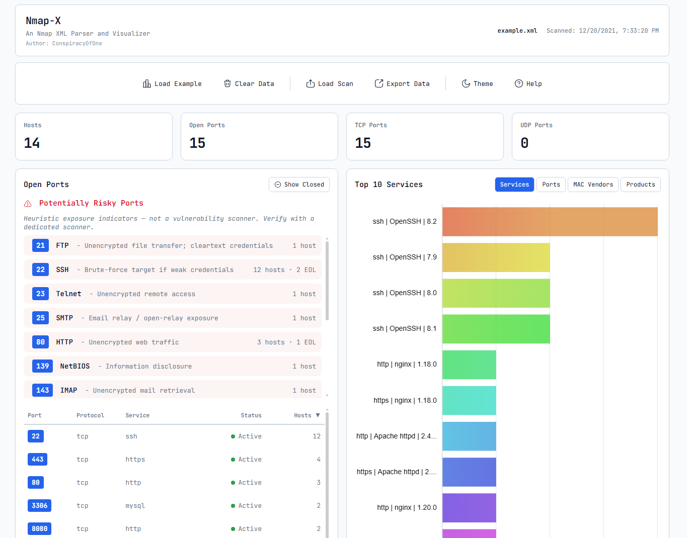
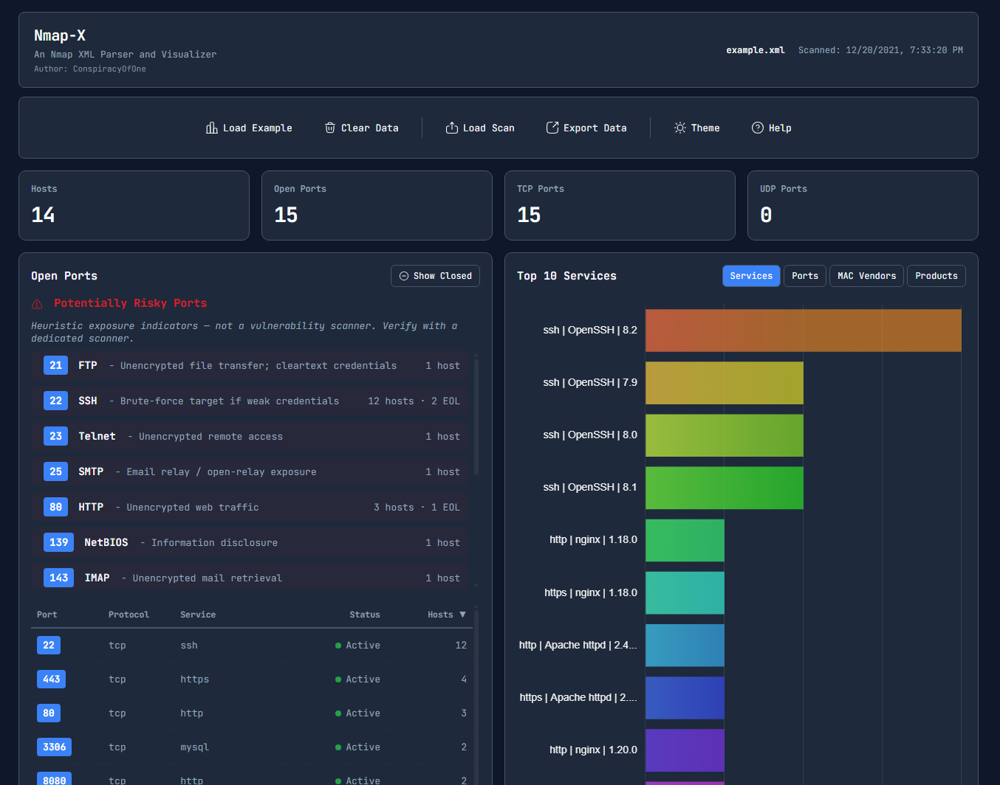

# Nmap-X Nmap XML Parser and Visualizer

**Single-file HTML/CSS/JS visualizer for Nmap XML scan reports.** Everything lives in `nmap-x.html` (~160 KB). No build step, no Node.js, no npm, no framework - just open it in any modern browser and start analyzing your scans.

## 📖 Overview

`nmap-x.html` is a self-contained tool for analyzing Nmap XML scan output. Drag and drop your Nmap XML report, and instantly get an interactive breakdown of your network's open ports, running services, hosts, and potential risks - all without installing anything.

Designed for security professionals, network administrators, and anyone who needs to quickly understand Nmap scan results without setting up a local development environment.

## ▶️ How to Run

1. **Open `nmap-x.html`** directly in any modern browser (Chrome, Firefox, Edge, Safari).
2. **Upload your Nmap XML scan** by dragging and dropping the file, or use the "Load Scan" button.

## 🔗 Merge Multiple Scan Files

If you have multiple Nmap XML files (e.g. nmap_tcp.xml, nmap_udp.xml), it is recommended to merge them to easily analyze the scans instead of opening the application in multiple tabs. Use the tool [nMap_Merger](https://github.com/CBHue/nMap_Merger).

## 🛠️ Key Features

### Scan Summary Dashboard

Get an instant snapshot of your scan results:
- **Hosts** - Distinct IP addresses discovered
- **Open Ports** - Unique open port numbers across all hosts
- **TCP Ports** - Unique open TCP port numbers
- **UDP Ports** - Unique open UDP port numbers

### Ports Table

A sortable, filterable table of every port found across your scan:
- Sort by port number, protocol, service name, status, or host count
- Open ports are color-coded green; inactive ports are color-coded red
- Service tooltips show full service details (name, product, version)
- Toggle to show or hide closed/filtered ports

### Host Inventory

Browse every host discovered in your scan:
- Expand each host to see its open ports in detail
- View IP address, hostname, MAC address, vendor, and OS detection
- Per-port details include service, product, version, extra info, CPEs, and NSE script output
- "View formatted" generates a clean, nmap-style plain-text report for each host
- "View raw" shows the original XML data
- Copy any host IP to clipboard with one click
- Search across all fields: IP, hostname, MAC, vendor, port, service, product, version
- Filter hosts by port, port number, service, vendor, or product
- Sort by IP, open port count, hostname, or filter match count
- Expand or collapse all hosts at once

### Risk & Vulnerability Indicators

A heuristic risk engine flags potentially exposed services:
- Identifies commonly risky ports (e.g., Telnet, SMB, RDP, FTP, databases)
- Severity tiers: Critical, High, Medium, Low
- NSE script escalation for known vulnerability indicators
- End-of-Life (EOL) product version detection
- Per-host risk scoring
- Disclaimer: These are heuristic exposure indicators - not a vulnerability scanner. Verify findings with a dedicated scanner.

### Interactive Charts

Visualize your scan data with theme-aware charts:
- **Top 10 Services** - Most common services across your hosts
- **Top 10 Open Ports** - Most frequently open port numbers
- **MAC Vendors** - Hosts grouped by hardware vendor
- **Products** - Hosts grouped by detected product
- Click any chart segment to filter your host inventory to matching results

### Data Export

Export your analysis in multiple formats:
- **JSON** - Complete parsed scan data
- **CSV** - Tabular data for spreadsheets and further analysis
- **PDF** - Printable report with scan summary, top ports, and risk findings

### Themes & Accessibility

- **Dark and Light modes** - Toggle with a single click; preference is remembered
- Responsive layout that adapts to desktop and mobile screens
- Keyboard shortcuts: `/` to search, `?` for help, `Esc` to close modals, `Ctrl+L` to load example, `Ctrl+K` to clear data

## 🎨 Themes

Nmap-X ships with two themes: dark and light. Toggle with a single click; your preference is remembered.

**Light mode:**

**Dark mode:**

## 🔒 Privacy

Your scan data never leaves your computer. The application processes everything locally in your browser - no data is uploaded to any server.

## 🌐 Browser Compatibility

Works in all modern browsers:
- Chrome (including headless)
- Firefox
- Edge
- Safari

No plugins or extensions required to open and parse a scan.

**Internet-dependent features:** Charts (Chart.js) and PDF export (jsPDF) are loaded from public CDNs. These work only when online; in offline or air-gapped environments charts render blank and PDF export is unavailable.

Built as a lightweight, single-file alternative to heavier Nmap visualization tools.